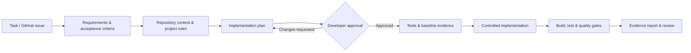
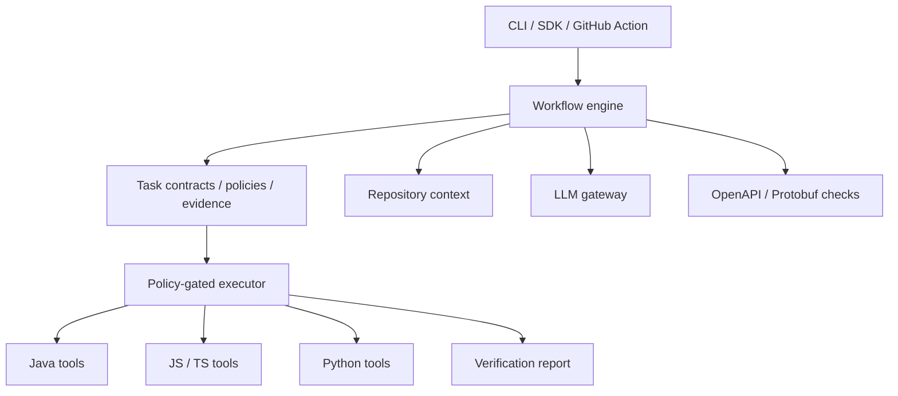

# DevFlow AI

[](https://github.com/mohamedyangui/DevFlow/actions/workflows/ci.yml)
[](LICENSE)
[](https://www.typescriptlang.org/)

### Engineering quality and verifiable delivery for AI-assisted software development.

**AI-generated code should come with evidence, not just confidence.**

DevFlow AI is an open-source, language-agnostic engineering workflow framework that turns software development tasks into **planned, tested, reviewable changes**. It brings requirements, acceptance criteria, project conventions, controlled execution, and verification evidence into one workflow.

> **The goal isn't to replace developers or coding agents. It's to make AI-assisted software delivery more reliable, traceable, and reviewable.**

**AI proposes. Deterministic tools verify. Developers stay in control.**

[Get started](#quickstart) · [See how it works](#how-it-works) · [Supported stacks](#supported-stacks) · [Example report](#what-does-the-evidence-look-like) · [Contribute](CONTRIBUTING.md)

---

## Why DevFlow?

Claude Code, Codex, GitHub Copilot, and other coding assistants can implement features quickly. But a successful build—or an agent saying *"done"*—doesn't establish that every acceptance criterion was addressed.

DevFlow provides a repeatable engineering process around those changes:

| Common problem | What DevFlow adds |
| --- | --- |
| Requirements are scattered across tickets and conversations | **Task contracts** with explicit, validated requirements and acceptance criteria |
| An agent overlooks edge cases or existing conventions | **Repository-aware analysis** and reviewable implementation plans |
| Tests exist but do not cover the requested behavior | **Acceptance-criteria-to-test traceability** and baseline/after-change evidence |
| Reviewers receive a large diff without context | **Evidence-based reports** with changes, test results, findings, and unresolved checks |
| Different projects use different test tools | **Stack-specific verification adapters** behind one CLI and workflow |
| AI-generated changes are applied without guardrails | **Human approvals**, scoped edits, command policies, and optional container isolation |

**For developers:** less manual coordination and more useful review evidence. **For teams:** a consistent way to evaluate AI-assisted changes across projects. These are product goals, not measured performance guarantees.

## How it works



1. **Describe the task.** Supply YAML, JSON, Markdown, or a GitHub issue. DevFlow validates the task contract and highlights incomplete criteria.
2. **Analyze the project.** Discover relevant modules, source files, contracts, engineering rules, dependencies, and potential contradictions.
3. **Approve the plan.** Review proposed files, risks, constraints, and test strategy before code changes begin.
4. **Design tests.** Associate automated tests with acceptance criteria; collect baseline evidence. New feature tests may fail meaningfully before implementation, while existing regression tests may already pass.
5. **Implement with guardrails.** Apply reviewable, scope-checked changes on a dedicated Git branch. Changes and bounded repair attempts require approval.
6. **Verify with real tools.** Run authorized build, test, lint, type-check, and compatible contract checks using the repository's actual toolchain.
7. **Review the evidence.** Distinguish what passed, failed, was skipped, was not executed, or remains unverified. Prepare a PR when explicitly authorized.

The **LLM proposes** analyses, plans, tests, and edits. DevFlow's **control layer** enforces approvals, scope, security, and budgets. Its **evidence layer** derives verification results from executed tools—not the model's confidence.

## Core capabilities

- **Task contracts:** YAML, JSON, and Markdown input; normalized IDs; acceptance criteria; constraints; definition of done; schema validation.
- **Repository intelligence:** context discovery, rule precedence, BM25 relevance ranking, Tree-sitter outlines, and read-only OpenAPI/Protobuf discovery.
- **AI-assisted engineering:** requirements analysis, clarification questions, implementation planning, test design, approved edits, bounded repair, and review.
- **Evidence-first verification:** normalized test results, baseline comparison, regression detection, acceptance-criteria coverage, and machine-readable/human-readable reports.
- **Security and control:** workspace trust, command fingerprints, scoped file changes, protected paths, audit logs, redaction, timeouts, and optional network-restricted Docker execution.
- **GitHub workflows:** issues as tasks, pull request reviews, opt-in comments/check runs, draft PR creation, and a GitHub Action with fork-safe workflow patterns.
- **Contract compatibility:** built-in OpenAPI and Protocol Buffers compatibility checks, with optional `oasdiff` and `buf` tools when installed and approved.
- **Language independence:** Java, JavaScript/TypeScript, Python, and mixed-language repositories use one common workflow.

## Quickstart

### Requirements

- **Node.js 22.13+** for development (Node 22.12+ supported by the CLI runtime)
- **pnpm 10** for building this source repository
- A supported project toolchain for the checks you want to run (for example, Java/Maven, Node.js/npm, or Python/pytest)
- An Anthropic or OpenAI API key for model-assisted steps
- Optional: **Docker** for the container execution backend

### 1. Install from source

```bash
git clone https://github.com/mohamedyangui/DevFlow.git
cd DevFlow
pnpm install --frozen-lockfile
pnpm build
node packages/cli/dist/bin.js --help
```

For now, **run DevFlow from a source checkout**. The repository's npm packages are private; do not assume that `npm install -g @devflow/cli` works until a package is officially published.

In the examples below, `devflow` means `node /absolute/path/to/DevFlow/packages/cli/dist/bin.js`. You can create a local shell alias, for example:

```bash
alias devflow='node /absolute/path/to/DevFlow/packages/cli/dist/bin.js'
```

Or, in PowerShell:

```powershell
function devflow { node 'D:\DevFlow\packages\cli\dist\bin.js' @args }
```

Adjust the path to your checkout. Run the commands from the **target application's repository root**, not the DevFlow source directory.

### 2. Initialize a project and validate a task

```bash
devflow init
devflow task validate tasks/add-pagination.yaml
```

Example task (`tasks/add-pagination.yaml`):

```yaml
id: TASK-142
title: Add pagination to the orders API
requirements:
  functional:
    - id: FR-1
      text: GET /api/orders accepts page and size query parameters.
  nonFunctional:
    - id: NFR-1
      text: Requests without pagination parameters keep their existing behavior.
      category: compatibility
acceptanceCriteria:
  - id: AC-1
    given: 25 orders exist
    when: A client requests page 1 with size 10
    then: The response includes orders 11 to 20
    covers: [FR-1]
    testLevel: integration
  - id: AC-2
    statement: Requests without pagination parameters retain their existing response format.
    covers: [NFR-1]
    testIntent: regression
constraints:
  - Preserve the existing OrderDto JSON shape.
testing:
  levels: [unit, integration]
definitionOfDone:
  - All required verification gates pass.
```

Additional sample task files: [`examples/tasks/`](examples/tasks/).

### 3. Analyze and approve a plan

Configure a supported provider using its environment variable (for example, `ANTHROPIC_API_KEY` or `OPENAI_API_KEY`). Select a valid model ID for your account. In the examples, replace `YOUR_MODEL_ID` and `RUN_ID` with actual values.

```bash
devflow plan --task tasks/add-pagination.yaml --model YOUR_MODEL_ID
# DevFlow shows the run ID and pauses for plan approval.
# Review .devflow/runs/RUN_ID/artifacts/plan.md before continuing.
devflow approve RUN_ID
devflow report RUN_ID
```

`analyze` and `plan` do not run project build commands or modify source files.

### 4. Implement and verify

Review the workspace configuration and trust only repositories you own or otherwise trust. Every executable verification command has its own approval fingerprint.

```bash
devflow trust
devflow run --task tasks/add-pagination.yaml --model YOUR_MODEL_ID
# Follow the returned run ID and approval checkpoints:
# Review the pending stage, then approve when instructed.
devflow status RUN_ID
devflow approve RUN_ID
# Repeat status/approval only for the next requested checkpoint.
devflow report RUN_ID
```

Approval steps can stop for clarification or command authorization; do not blindly repeat them. Use `devflow status RUN_ID`, `devflow resume RUN_ID`, and the displayed instructions to proceed safely. `devflow verify` can also run the project's approved quality gates independently.

## What does the evidence look like?

An **illustrative** acceptance-criteria matrix (not the output of a specific DevFlow run):

| Criterion | Verification evidence | Status |
| --- | --- | --- |
| AC-01: Valid order cancellation | JUnit test executed successfully | **Verified** |
| AC-02: Paid orders cannot be cancelled | Negative test executed successfully | **Verified** |
| AC-03: Existing API clients remain compatible | No integration evidence available | **Unverified** |
| AC-04: Audit trail meets business policy | Manual review required | **Manual** |

A passing test is evidence about the behavior it exercises, **not proof of complete business correctness**. A final verdict is `verified` only when the framework's required gates and automated acceptance criteria meet the verification policy. Unexecuted checks never become passes, and AI-only review findings are not presented as confirmed defects.

DevFlow stores structured run artifacts under `.devflow/runs/` and produces JSON and Markdown reports so developers can inspect the reasoning trail and reproduce the checks.

## Supported stacks

| Ecosystem | Detection and conventions | Verification |
| --- | --- | --- |
| **Java** | Maven, Gradle, Spring Boot, multi-module projects | JUnit, TestNG, compiler output, Checkstyle, SpotBugs and other configured tools |
| **JavaScript / TypeScript** | npm, pnpm, Yarn, Bun; Express, NestJS, React, Next.js, Angular, Vue | Jest, Vitest, ESLint, TypeScript, Playwright and other configured tools |
| **Python** | pip, uv, Poetry; Django, Flask, FastAPI | pytest, unittest, Ruff, flake8, mypy and other configured tools |
| **Mixed repositories** | Per-module stack discovery and shared contracts | Consistent result statuses across modules |

**Why adapters?** DevFlow does not need to teach Claude Code or Codex how to write Java or TypeScript. An adapter discovers the stack, selects constrained verification commands, parses machine-readable results, and maps evidence back to the shared task contract. Language-specific tools stay behind one language-independent workflow.

See [language adapter specification](docs/specs/language-adapter.md) and [example repositories](examples/README.md).

## Developer workflows

| Mode | Example | Purpose |
| --- | --- | --- |
| **Assist** | `devflow plan --task task.yaml` | Analyze and plan without writing code |
| **Test** | `devflow test --task task.yaml` | Create and approve tests; record baseline evidence |
| **Implement** | `devflow run --task task.yaml` | Generate tests and implementation through human approvals |
| **Verify** | `devflow verify` | Execute the configured quality gates |
| **Review** | `devflow review --task task.yaml --base main` | Assess changes, evidence, risks, and rule violations |
| **Contract diff** | `devflow contracts diff` | Examine OpenAPI/Protobuf compatibility; see CLI help for required inputs |

See the [CLI reference](docs/specs/cli.md) for flags, permissions, run states, budgets, and exit codes.

### Use GitHub issues as tasks

```bash
devflow plan --issue 142 --repo owner/repository --model YOUR_MODEL_ID
```

DevFlow reads the issue as **untrusted task data**. It does not treat issue text as permission to run commands or access secrets.

### Review a pull request

Check out the PR's head commit first; DevFlow does not fetch and execute untrusted pull request code on its own.

```bash
devflow review --task tasks/task.yaml --pr 57 --model YOUR_MODEL_ID
# Publishing is opt-in:
# devflow review --task tasks/task.yaml --pr 57 --model YOUR_MODEL_ID --publish comment
```

PR code from forks is **not executed by default**. Publishing findings requires explicit authorization and appropriate GitHub permissions.

### Prepare a draft PR

```bash
devflow pr create RUN_ID       # preview only
devflow pr create RUN_ID --yes # explicitly push the DevFlow branch and open a draft PR
```

DevFlow never force-pushes or merges automatically. The opt-in draft PR operation **can push** the run branch; this is deliberately separate from local implementation.

### GitHub Actions

The repository includes a composite [`action.yml`](action.yml) plus examples for [fork-safe verification](docs/examples/github-actions/devflow-verify.yml) and [gated AI review](docs/examples/github-actions/devflow-review.yml). Pin the action to a reviewed commit SHA, configure approved command fingerprints, and keep untrusted-code execution separate from jobs holding model API keys.

For setup details and required permissions, see the [GitHub Action specification](docs/specs/github-action.md).

## Using DevFlow with Claude Code, Codex, or another agent

DevFlow can complement an existing coding agent: **the agent implements**, while **DevFlow organizes requirements and provides standardized verification evidence**. Agents with terminal access can invoke the DevFlow CLI when the developer authorizes the relevant commands.

For example, an instruction to a coding agent could be:

> Use DevFlow to validate TASK-142, inspect the project's engineering rules, propose a plan for my review, implement the approved change, and show the DevFlow verification report. Do not bypass approval checkpoints or claim unexecuted checks passed.

**Native MCP integration is a separate integration milestone**, not implied by the presence of Java/JavaScript/Python adapters. Only advertise MCP tools and an MCP installation command once an actual MCP server package and compatibility tests are available.

## Security model

DevFlow is designed around **least privilege and explicit approval**:

- **No arbitrary model-generated shell execution.** The model can select only validated commands from an adapter-produced catalog; command policy and approvals control execution.
- **Scoped source edits.** Changes are checked against the approved plan, protected paths, repository boundaries, and content hashes.
- **Workspace trust.** Repository configuration does not grant itself permission to execute commands. Trust and command fingerprints are stored outside the repository.
- **Secret handling.** Sensitive files are excluded from model context where possible; outputs are screened and redacted. Redaction lowers risk but is not a guarantee of perfect secret detection.
- **Auditable results.** Actual execution records determine statuses; suspicious AI review findings remain unverified without supporting deterministic evidence.
- **Optional Docker backend.** Restricted execution uses a configured container with network isolation and resource limits. Isolation reduces risk but does not eliminate it.
- **Human-controlled delivery.** Approvals precede significant changes; PR publication is opt-in; automatic merge and force-push are prohibited.

**Never run a repository's build or tests unless you trust the code and its dependencies.** Build scripts and plugins may execute code. See the full [security model](docs/specs/security-model.md) and [security policy](SECURITY.md).

## Architecture



| Package | Purpose |
| --- | --- |
| `@devflow/core` | Task schemas, adapter ports, security policy, execution and evidence model |
| `@devflow/workflow` | State machine, approvals, implementation steps, history and reports |
| `@devflow/context` | Repository discovery, code context and rules |
| `@devflow/ai` | Anthropic, OpenAI, Fake/Replay providers, usage and budget controls |
| `@devflow/adapter-java` | Java-specific build, test and quality-gate intelligence |
| `@devflow/adapter-javascript` | JavaScript/TypeScript-specific tooling and result parsing |
| `@devflow/adapter-python` | Python-specific discovery and verification |
| `@devflow/contracts` | OpenAPI and Protobuf compatibility analysis |
| `@devflow/github` | GitHub issue, review and PR integration |
| `@devflow/cli` | Developer command-line interface |

Read the [architecture overview](docs/architecture/overview.md), [ADRs](docs/adr/README.md), and [technical specifications](docs/specs/).

## Development and testing

```bash
pnpm install --frozen-lockfile
pnpm check          # build, typecheck, lint, formatting, unit / repository tests
pnpm test:examples  # real-toolchain integration tests; requires matching toolchains
```

The repository's [GitHub Actions CI](https://github.com/mohamedyangui/DevFlow/actions/workflows/ci.yml) runs a Node.js matrix on Ubuntu and Windows. Some integration tests require local Java/Python toolchains or model API credentials and may be skipped in the default suite. Consult the CI logs for the current executed and skipped test counts.

## Documentation

- [Getting started and CLI specification](docs/specs/cli.md)
- [Task contracts](docs/specs/task-contract.md)
- [Project configuration](docs/specs/project-config.md)
- [Language adapters](docs/specs/language-adapter.md)
- [Context engine](docs/specs/context-engine.md)
- [Verification and evidence](docs/specs/verification-and-evidence.md)
- [Security model](docs/specs/security-model.md)
- [GitHub Action](docs/specs/github-action.md)
- [Examples](examples/README.md)
- [Roadmap](docs/roadmap.md)

## Contributing

Contributions are welcome: bug reports, reproducible test cases, adapter improvements, documentation, security hardening, and real-world examples.

1. Read [CONTRIBUTING.md](CONTRIBUTING.md) and the [security policy](SECURITY.md).
2. Open an [issue](https://github.com/mohamedyangui/DevFlow/issues) to discuss a significant change.
3. Include tests and verification evidence in your pull request.

For security concerns, follow [SECURITY.md](SECURITY.md) rather than publishing sensitive details in a public issue.

## License and maintainer

Licensed under [Apache License 2.0](LICENSE).

Created and maintained by **[Mohamed Yangui](https://github.com/mohamedyangui)**.

**Build with AI. Verify with evidence. Keep developers in control.**
