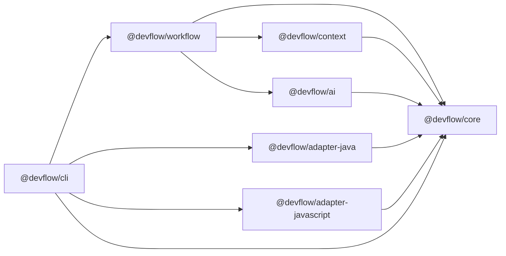

# Architecture overview

This is the maintained summary of DevFlow's architecture. The full reasoning, including the
options that were rejected, is in the [architecture proposal](../design/architecture-proposal.md)
(approved 2026-11-06) and the [ADRs](../adr/README.md). What is implemented today is tracked in
the [roadmap](../roadmap.md).

## 1. What DevFlow is

DevFlow AI is an engineering workflow framework: it takes a development task with requirements
and acceptance criteria, gathers the relevant context from a repository, plans, writes tests
and code with a language model, verifies the result with the project's own build and test
tools, and produces a report in which every status is backed by evidence.

It is language-agnostic. Language knowledge lives in adapters; the first two cover Java
(Maven, Gradle, Spring Boot, JUnit) and JavaScript/TypeScript (npm, pnpm, yarn, Jest, Vitest,
ESLint, tsc).

## 2. Guiding principle: the AI proposes, deterministic code decides

| Plane     | Implemented by                                   | Responsibilities                                                                     | Trust                                      |
| --------- | ------------------------------------------------ | ------------------------------------------------------------------------------------ | ------------------------------------------ |
| Reasoning | Language model                                   | Interpret requirements, propose plans, draft tests and code, suggest review findings | Untrusted: output is schema-validated data |
| Control   | Deterministic TypeScript                         | State machine, approvals, security policy, path guard, budgets, scope enforcement    | Trusted                                    |
| Evidence  | Deterministic TypeScript and the project's tools | Run builds and tests, parse results, compute traceability, render reports            | Source of truth for every status           |

Consequences:

1. The model never produces a command that gets executed; it selects from a catalog
   ([ADR 0006](../adr/0006-llm-output-is-data.md)).
2. The model never writes files; it returns edits that the control plane checks and applies.
3. Every reported status comes from the evidence plane; AI findings stay unverified until
   deterministic evidence exists ([ADR 0013](../adr/0013-report-and-status-semantics.md)).

## 3. Packages

| Package                       | Responsibility                                                                             | Phase 1 state                                    |
| ----------------------------- | ------------------------------------------------------------------------------------------ | ------------------------------------------------ |
| `@devflow/core`               | Schemas, domain rules, ports, errors, task loading; later the security policy and executor | Implemented: schemas, rules, ports, task loading |
| `@devflow/context`            | Discovery, classification, instructions, ranking, packing, contract discovery              | Skeleton (exports nothing)                       |
| `@devflow/ai`                 | Model gateway; Anthropic, OpenAI, Fake and Replay providers                                | Skeleton                                         |
| `@devflow/adapter-java`       | Maven, Gradle, Spring Boot, JUnit 5, Mockito, Checkstyle, SpotBugs                         | Skeleton                                         |
| `@devflow/adapter-javascript` | npm, pnpm, yarn, Express, NestJS, React, Next.js, Jest, Vitest, ESLint, tsc                | Skeleton                                         |
| `@devflow/workflow`           | State machine, steps, run store, reports, SDK entry point                                  | Skeleton                                         |
| `@devflow/cli`                | The `devflow` binary, composition root                                                     | `--version`, `task validate`                     |

Boundaries are declared once in the root `package.json` and enforced by ESLint, repository
tests and TypeScript project references ([ADR 0003](../adr/0003-package-boundaries.md)).
`@devflow/github` (Phase 5) and `@devflow/contracts` (Phase 6) will be added later.

## 4. Public interfaces in `@devflow/core`

- **Task contract:** `TaskFile` (authoring format), `TaskContract` (normalized), and the
  loaders `loadTaskFile`, `parseTaskText`, `validateTaskInput`, `normalizeTask`, `lintTask`
  ([spec](../specs/task-contract.md)).
- **Configuration:** `ProjectConfig` ([spec](../specs/project-config.md)).
- **Modules and adapters:** `ModuleCandidate`, `ModuleProfile` (with `ContractRelation`),
  `InferredConvention`, `TestInventory`, `TestAuthoringGuide`, and the `LanguageAdapter` port
  ([spec](../specs/language-adapter.md)).
- **Commands:** `CommandSpec`, `ExecutionRecord`, `InvocationStrategy`.
- **Verification:** `TestOutcome`, `ResultStatus`, `TestEvidence`, `TestCaseResult`,
  `GateResult`, `ParsedCommandResults`, and the rules `assessTestEvidence` and
  `statusForOutcome` ([spec](../specs/verification-and-evidence.md)).
- **Review and reports:** `Finding`, `ImplementationPlan`, `AcceptanceMatrixRow`,
  `EngineeringReport`.
- **Workflow:** `WorkflowState`, `WorkflowMode`, `isTerminalState`.
- **Ports:** `RepositoryView`, `LanguageAdapter`, `ToolchainProbe`, `LlmProvider`,
  `IssueSource`.
- **Errors:** `DevflowError` with stable `ErrorCode`s.
- **JSON Schema:** `taskFileJsonSchema()`, `projectConfigJsonSchema()`.

Ports for the executor, run store and source parser are defined together with their
implementations (Phases 2–3), so they are shaped by real use rather than guessed.

## 5. Workflow (Phases 2–4)

States: `TASK_RECEIVED → CONTEXT_LOADING → REQUIREMENTS_ANALYSIS (⇄ CLARIFICATION_REQUIRED) →
PLANNING → AWAITING_PLAN_APPROVAL → TEST_DESIGN → IMPLEMENTATION ⇄ VERIFICATION → REVIEW →
COMPLETED`, plus `FAILED` and `CANCELLED`. Modes select a path through the states:

| Mode        | Modifies code   | Path                                          |
| ----------- | --------------- | --------------------------------------------- |
| `assist`    | no              | analysis and planning only                    |
| `test`      | test files only | through test design and verification          |
| `implement` | yes             | full path with a bounded repair loop          |
| `review`    | no              | verification and review of an existing change |

Runs are persisted under `.devflow/runs/<run-id>/` and can be resumed
([ADR 0004](../adr/0004-state-machine-and-run-store.md)). Each model-using step is one bounded
loop with read-only tools ([ADR 0005](../adr/0005-single-agent-loop.md)).

## 6. Security

Repository content is untrusted; local build execution happens only in workspaces the user has
trusted, with approved command fingerprints, a scrubbed environment, timeouts and output caps.
Windows batch wrappers have a dedicated, restricted invocation path
([ADR 0014](../adr/0014-windows-invocation.md)). Details and residual risks:
[security model](../specs/security-model.md).

## 7. Developer experience: one CLI and SDK for Java and JS/TS

The approval asked that Java developers and JavaScript/TypeScript developers use the same CLI
and SDK, including in mixed-language monorepos. The design guarantees this structurally:

- **One task format.** Task files describe behaviour (requirements, acceptance criteria), not
  language constructs. The same file drives a Spring Boot change or a React change.
- **One CLI.** `devflow` has no language-specific commands or flags. The language is detected
  per module by the adapters.
- **Modules, not repositories.** A repository is a set of modules, each owned by one adapter. A
  monorepo with `backend/` (Maven) and `web/` (pnpm) has two modules; gates are configured per
  module (`backend-test`, `web-lint`), and a task can span both.
- **Uniform evidence.** JUnit XML and Vitest JSON are both parsed into the same
  `ParsedCommandResults`, so reports, statuses and acceptance matrices look the same for every
  language.
- **Shared contracts.** Protobuf and OpenAPI files link modules across languages
  ([ADR 0017](../adr/0017-contract-aware-context.md)), so a change to a shared message surfaces
  both the Java and the TypeScript side.
- **Familiar conventions per language.** Tests are written the way each ecosystem expects (JUnit
  5 with `@DisplayName`, Vitest/Jest `it(...)` titles), with the acceptance-criterion marker in
  the test name ([language adapter spec](../specs/language-adapter.md)).
- **No Node expertise required to use it.** Java developers need Node 22+ to run the CLI, but no
  JavaScript project setup. Distribution as a standalone binary can be evaluated after the MVP.
